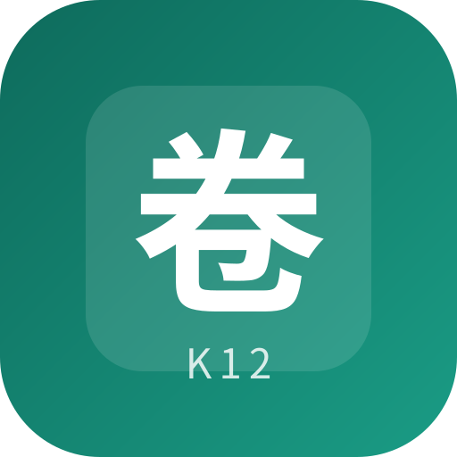

<div align="center">
  
  <h1>组卷台</h1>
  <p>一个简单好用的中小学智能题库</p>
  <p>数学 · 语文 · 英语 · 物理 · 化学</p>
  <p><a href="https://your98k.github.io/k12-ai-question-bank/"><strong>立即开始组卷 →</strong></a></p>
</div>

## 功能亮点

- **灵活组卷**：按学段、年级、学期、知识点和难度生成练习卷。
- **两种出题方式**：本地模板随机生成，或用个人 API 生成 AI 原创新题；AI 题支持单题换新。
- **练习与导出**：错题本、答案解析，支持打印 / PDF、Word 和复制文本。
- **离线使用**：可添加到手机主屏幕；首次缓存完成后，本地出题可离线使用。

## 使用 AI 出题

选择「AI 原创新题」→「API 设置」，填写 **OpenAI 兼容接口**的 HTTPS 地址、模型 ID 和个人 API Key，即可按当前条件出卷。接口需支持浏览器 **CORS 跨域**。

- Key 仅保存在当前页面内存，刷新后需重填；接口地址和模型保存在本机。
- 只有点击 AI 生成或换题才会调用接口，费用按服务商规则计算；取消后，已发出的请求仍可能收费。每卷最多 40 题，每批最多 5 题。
- AI 题为**原创练习，不是最新真题**；程序只做结构和重复检查，答案及解析请在使用前核验。

> 错题记录保存在当前设备，清理浏览器数据可能导致记录丢失。

## 本地开发

需要 Node.js 22+。

```bash
npm ci
npm run preview  # http://127.0.0.1:8080/k12-ai-question-bank/
```

`npm run build` 构建到 `_site/`，`npm test` 运行测试。推送到 `main` 后，GitHub Actions 会自动测试并部署到 Pages。

## 许可证

本项目采用 [MIT License](LICENSE)。KaTeX、图标字形等第三方内容遵循各自的许可证；外部题目接入前请确认使用授权。
